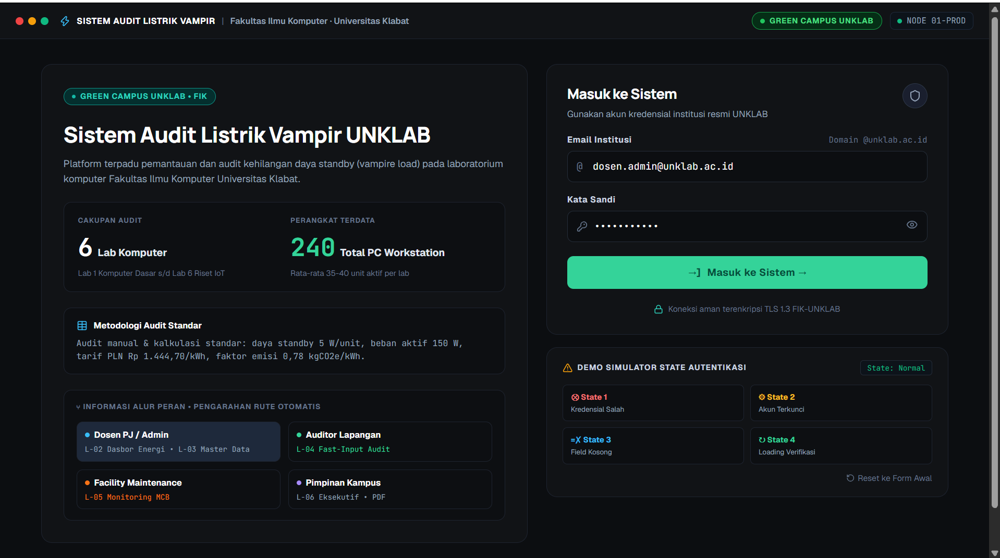
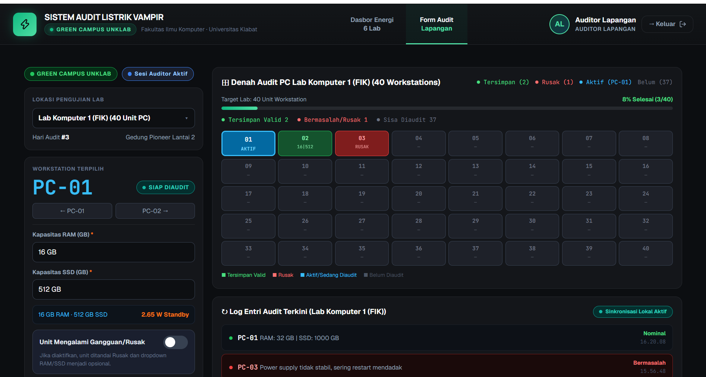
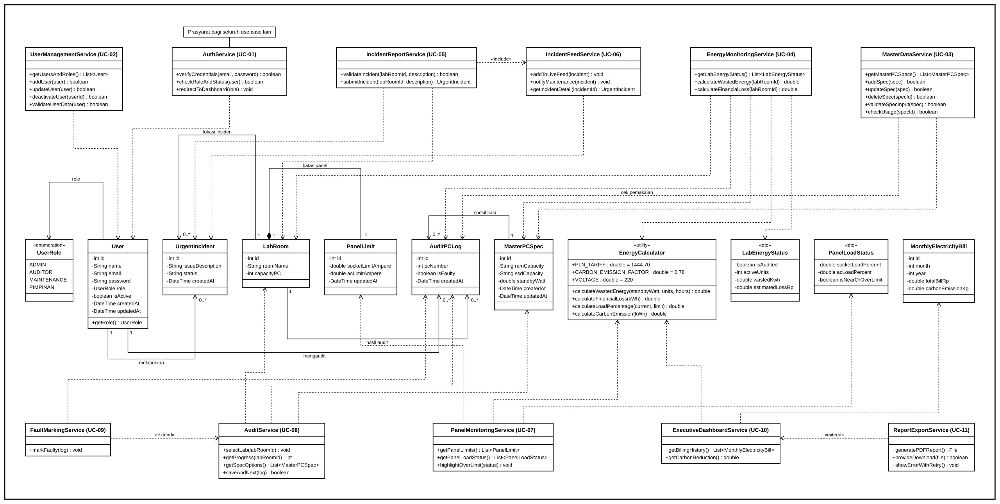

# Sistem Audit Listrik Vampir (Vampire Power & Standby Energy Monitor)

Sistem informasi berbasis web (*client-server*) untuk pemantauan dan audit efisiensi energi listrik di Laboratorium Komputer dan Fasilitas Universitas Klabat (UNKLAB) yang membantu Dosen Penanggung Jawab Lab (Admin), Auditor Lapangan, Facility Maintenance, dan Pimpinan Kampus dalam mendata unit PC secara cepat (*fast-input*), memantau kapasitas beban panel MCB, menangani insiden tegangan listrik, serta menganalisis estimasi pemborosan energi listrik standby (*vampire power*), kerugian finansial, dan reduksi jejak emisi karbon (*Green Campus*).




| | |
|---|---|
| **Mata kuliah** | System Analysis and Design — Fakultas Ilmu Komputer, Universitas Klabat |
| **Kelompok** | SADboy |
| **Objek / studi kasus** | 6 Ruang Laboratorium Komputer dan Fasilitas, Universitas Klabat (UNKLAB) |
| **Model SDLC** | Incremental Model (4 Increment berurutan + Integrasi & Pengujian Akhir) |
| **Dokumen SRS** | [docs/SAD_FP_Sistem_Audit_Listrik_Vampir_SRS.pdf](docs/SAD_FP_Sistem_Audit_Listrik_Vampir_SRS.pdf) |
| **Prototipe UI** | [https://stitch.google.com/projects/1475919140937090940](https://stitch.google.com/projects/1475919140937090940) |

## Anggota Kelompok

| No | Nama | NIM | Peran | Kontribusi utama |
|----|------|-----|-------|------------------|
| 1 | Mumek, Hernan Aprily | 105012410113 | Project Manager | Bab 1–3 SRS, Pendahuluan, Model SDLC, Elisitasi Kebutuhan, & koordinasi stakeholder |
| 2 | Santoso, Abdillah Rafdy | 105022410089 | FS Dev 1 | Skema Database (ERD), Class Diagram, kalkulasi energi, modul RBAC & pemantauan lab |
| 3 | Kembuan, Fledio Jonathan | 105022410017 | Fullstack Dev 2 | Use Case Diagram, Spesifikasi Use Case (UC-01 s/d UC-11), Activity Diagram, fast-input dropdown, & integrasi pelaporan insiden |
| 4 | Kalengkongan, Jofan | 10502251009 | UI/UX Designer | Mockup antarmuka responsif (Dosen Admin, Auditor Dropdown, Maintenance, Eksekutif) via Google Stitch |
| 5 | Christian Junior | 105012510030 | QA | Matriks Keterlacakan (RTM), NFR, verifikasi formula matematika energi, & pengujian sistem |

## Latar Belakang

- **Masalah:** Beban listrik puncak kampus Universitas Klabat mencapai kisaran 400 Ampere pada siang hari dengan tagihan bulanan berkisar Rp 60 Juta hingga Rp 70+ Juta. Pendataan 210–240 unit PC (35–40 unit per ruang di 6 laboratorium komputer) memakan waktu 1–3 hari kerja secara manual. Dosen kesulitan memantau serentak perangkat yang belum dimatikan setelah jam perkuliahan/praktikum (*vampire power*), serta terdapat risiko kelebihan beban (*MCB trip*) pada grup stopkontak 10A (≈2.200 W) dan panel pendingin AC 40A (≈8.800 W).
- **Kondisi saat ini:** Pendataan spesifikasi dan kondisi fisik PC masih menggunakan lembaran kertas atau *spreadsheet* manual tanpa adanya basis data terpusat. Sementara itu, pemantauan riwayat tagihan listrik kampus diperiksa terpisah melalui aplikasi pihak ketiga PLN Mobile secara global tanpa rincian konsumsi per ruang laboratorium.
- **Tujuan sistem:** Mengembangkan aplikasi terpusat untuk memangkas waktu pendataan spesifikasi PC di 6 lab menjadi hitungan detik per unit via *fast-input dropdown*, mencegah insiden *MCB trip* melalui peringatan dini visual beban panel, menekan pemborosan biaya listrik kampus, serta mendukung evaluasi kebijakan *Green Campus* melalui perhitungan estimasi energi terbuang (kWh), kerugian finansial (Rp), dan reduksi emisi karbon ($CO_2$).
- **Pengguna (aktor):**
  1. **Dosen Penanggung Jawab / Admin:** Mengelola akun/RBAC, master data spesifikasi perangkat, memantau dasbor energi enam lab, mengelola log audit, dan melaporkan indikasi tegangan abnormal.
  2. **Auditor Lapangan:** Asisten lab/mahasiswa yang mengaudit 35–40 PC per lab menggunakan formulir *fast-input dropdown* dan menandai unit yang bermasalah/rusak (*toggle is_faulty*).
  3. **Facility Maintenance:** Tim teknis di bawah pimpinan Wakil Rektor II yang memantau batas aman beban MCB 10A/40A, menerima *urgent incident report* secara *real-time*, dan menindaklanjuti rekomendasi penghematan energi.
  4. **Pimpinan Kampus (Rektorat / WR II / Business Office):** Pengambil keputusan yang memantau dasbor ringkasan eksekutif, tren biaya listrik bulanan, evaluasi efisiensi daya standby, dan mengunduh laporan resmi berformat PDF.

## Fitur Utama

| No | Fitur | Aktor | Use case | Kebutuhan |
|----|-------|-------|----------|-----------|
| 1 | Autentikasi & Login System | Semua Aktor | UC-01 | NFR-04, NFR-SEC-01 |
| 2 | Kelola User & Hak Akses (RBAC) | Dosen Admin | UC-02 | FR-01 (FR-ADM-01) |
| 3 | Kelola Master Data Perangkat (RAM, SSD, Standby Watt) | Dosen Penanggung Jawab / Admin | UC-03 | FR-03 (FR-ADM-03) |
| 4 | Memantau Dasbor Energi 6 Lab | Dosen Penanggung Jawab / Admin | UC-04 | FR-02 (FR-ADM-02) |
| 5 | Mengirim Report Incident Tegangan | Dosen Penanggung Jawab / Admin | UC-05 | FR-04 (FR-ADM-04) |
| 6 | Menerima Feed Incident Real-Time | Facility Maintenance | UC-06 | FR-04 (FR-ADM-04) |
| 7 | Memantau Beban Panel MCB 10A/40A | Facility Maintenance | UC-07 | FR-07 (FR-PANEL-01) |
| 8 | Fast-Input Audit Spesifikasi PC | Auditor Lapangan | UC-08 | FR-05 (FR-AUD-01) |
| 9 | Menandai Status PC Rusak | Auditor Lapangan | UC-09 | FR-06 (FR-AUD-02) |
| 10 | Memantau Dasbor Eksekutif | Pimpinan Kampus | UC-10 | FR-08 (FR-EXEC-01) |
| 11 | Mengunduh Laporan Resmi PDF | Pimpinan Kampus | UC-11 | FR-09 (FR-EXEC-02) |

### Aturan Bisnis Perhitungan (SRS 5.1):
* **BR-01:** Beban grup stopkontak dengan MCB 10 Ampere maksimal 2.200 Watt. Peringatan visual diberikan jika akumulasi daya melampaui batas.
* **BR-02:** Beban arus pada panel AC dengan MCB 40 Ampere maksimal 40 Ampere.
* **BR-03:** Energi terbuang dihitung dengan rumus: $E_{kWh} = \frac{P_{standby} \times t_{jam}}{1000}$.
* **BR-04:** Kerugian finansial dihitung dengan rumus: $\text{Biaya} = E_{kWh} \times \text{Tarif PLN B-2/P-1}$ (Rp 1.444,70/kWh).
* **BR-05:** Estimasi emisi karbon dihitung dengan rumus: $\text{Emisi } CO_2 = E_{kWh} \times 0{,}78\text{ kg } CO_2e\text{/kWh}$.

## Screenshot

**[L-01 / UC-01] Login System Multi-Role & RBAC**


**[L-04 / UC-08 & UC-09] Fast-Input Audit Spesifikasi PC (Dropdown RAM/SSD & Toggle Rusak)**



**Validasi Input Sistem (SRS 5.5)**

Validasi kelengkapan data diterapkan pada seluruh modul:
- `standby_watt` wajib berupa angka positif (> 0 Watt), kombinasi RAM, SSD, dan Watt tidak boleh duplikat.
- Email pengguna berstatus *Unique Key*, akun nonaktif (`is_active = false`) ditolak saat login.
- Validasi beban MCB memberikan indikator *overload warning* jika melampaui ambang batas aman.

## Teknologi

| Lapisan | Teknologi | Versi |
|---------|-----------|-------|
| Front-end | HTML5, Tailwind CSS, React.js, Vite, Lucide Icons | React 19, Vite 8 |
| Back-end | PHP (Framework Laravel LTS), RESTful API, Laravel Sanctum, DomPDF | Laravel 13, PHP 8.3 |
| Database | MySQL / MariaDB Relational Database (7 Tabel Terpusat) | MySQL 8.x |
| Hosting / lingkungan uji | Localhost (Laragon/XAMPP) & Jaringan Wi-Fi Kampus UNKLAB | HTTP / HTTPS |
| Tools pemodelan | Figma, Draw.io / Visual Paradigm, PlantUML | draw.io v24+ |
| Prototipe UI | Google Stitch | Cloud Web |

## Kebutuhan Sistem

- PHP 8.3 atau lebih baru (ekstensi `pdo_mysql`, `mbstring`, `openssl`, `xml`, `curl` aktif)
- Composer 2.7+
- Node.js 20.x+ dan npm 10.x+
- Database Server MySQL 8.0+ atau MariaDB 10.4+
- Git Version Control
- Web browser modern (Google Chrome, Microsoft Edge, Mozilla Firefox)

## Instalasi dan Menjalankan Aplikasi

1. Clone repository:

   ```bash
   git clone https://github.com/flediokembuan/VampirAudit---SISTEM.git
   cd VampirAudit---SISTEM
   ```

2. Setup Backend (Laravel API):

   ```bash
   cd backend
   composer install
   cp .env.example .env
   php artisan key:generate
   ```

   Sesuaikan pengaturan database di berkas `.env`:
   ```env
   DB_CONNECTION=mysql
   DB_HOST=127.0.0.1
   DB_PORT=3306
   DB_DATABASE=vampir_audit
   DB_USERNAME=root
   DB_PASSWORD=
   ```

   Jalankan migrasi tabel dan data awal (seeder):
   ```bash
   php artisan migrate --seed
   php artisan serve
   ```
   *Backend API berjalan pada `http://127.0.0.1:8000`.*

3. Setup Frontend (React + Vite):

   Buka jendela terminal baru:
   ```bash
   cd frontend
   npm install
   npm run dev
   ```
   *Aplikasi web berjalan pada `http://localhost:5173`.*

### Akun Uji

Akun pengujian disediakan otomatis oleh seeder database (`UserSeeder.php`) dengan password standar: `Vampir#2026`.

| Aktor | Username / Email | Password | Hak Akses |
|-------|------------------|----------|-----------|
| Dosen Admin | `admin@unklab.ac.id` | `Vampir#2026` | Akses penuh: RBAC User, Master Data PC, Dasbor 6 Lab, Kirim Insiden |
| Dosen Admin (Alternatif) | `dosen.admin@unklab.ac.id` | `Vampir#2026` | Administrator Sistem & Penanggung Jawab Lab |
| Auditor Lapangan | `auditor@unklab.ac.id` | `Vampir#2026` | Formulir Fast-Input Audit 6 Lab & Penandaan PC Rusak |
| Facility Maintenance | `maintenance@unklab.ac.id` | `Vampir#2026` | Pemantauan Beban MCB 10A/40A & Live Incident Feed |
| Pimpinan Kampus | `pimpinan@unklab.ac.id` | `Vampir#2026` | Dasbor Eksekutif Tren Tagihan Listrik & Unduh Laporan PDF |

## Struktur Folder

Struktur direktori kode mengikuti arsitektur modular yang dirancang pada *Class Diagram* (SRS 7.2) dan *Model Data* (SRS Bagian 8):

```text
VampirAudit---SISTEM/
├── backend/                             # Lapisan Back-end (Laravel LTS - PHP 8.3 RESTful API)
│   ├── app/
│   │   ├── Enums/
│   │   │   ├── IncidentStatus.php       # Nilai status insiden (OPEN, IN_PROGRESS, RESOLVED)
│   │   │   └── UserRole.php             # Enumerasi 4 role (ADMIN, AUDITOR, MAINTENANCE, PIMPINAN)
│   │   ├── Http/
│   │   │   ├── Controllers/Api/         # Kelas Controller mengimplementasikan alur Use Case
│   │   │   │   ├── AuthController.php                   # UC-01: AuthService (Autentikasi & Login)
│   │   │   │   ├── UserController.php                   # UC-02: UserManagementService (RBAC)
│   │   │   │   ├── MasterPcSpecController.php           # UC-03: MasterDataService (Spek RAM/SSD/Watt)
│   │   │   │   ├── DashboardController.php              # UC-04: EnergyMonitoringService (Energi 6 Lab)
│   │   │   │   ├── UrgentIncidentController.php         # UC-05, UC-06: IncidentReport & Feed Service
│   │   │   │   ├── PanelReadingController.php           # UC-07: PanelMonitoringService (Beban MCB)
│   │   │   │   ├── PanelLimitController.php             # UC-07: Konfigurasi batas 10A/40A
│   │   │   │   ├── AuditPcLogController.php             # UC-08, UC-09: AuditService & FaultMarking
│   │   │   │   ├── MonthlyElectricityBillController.php # UC-10: Pencatatan histori tagihan PLN
│   │   │   │   ├── ExecutiveReportController.php        # UC-10, UC-11: ReportExportService (Unduh PDF)
│   │   │   │   ├── LabRoomController.php                # Master data 6 ruang laboratorium
│   │   │   │   └── SettingController.php                # EnergyCalculator: Parameter tarif & emisi
│   │   │   └── Middleware/              # Proteksi rute berbasis Role-Based Access Control
│   │   └── Models/                      # Kelas Entity Eloquent sesuai Class Diagram & ERD
│   │       ├── User.php                 # Entity User (tabel users)
│   │       ├── LabRoom.php              # Entity LabRoom (tabel lab_rooms)
│   │       ├── MasterPcSpec.php         # Entity MasterPCSpec (tabel master_pc_specs)
│   │       ├── AuditPcLog.php           # Entity AuditPCLog (tabel audit_pc_logs)
│   │       ├── PanelLimit.php           # Entity PanelLimit (tabel panel_limits)
│   │       ├── PanelReading.php         # Entity pembacaan beban panel
│   │       ├── UrgentIncident.php       # Entity UrgentIncident (tabel urgent_incidents)
│   │       ├── MonthlyElectricityBill.php # Entity MonthlyElectricityBill (tabel tagihan listrik)
│   │       ├── Setting.php              # Entity variabel tarif PLN & faktor emisi
│   │       └── SettingHistory.php       # Entity histori pembaruan pengaturan
│   ├── database/
│   │   ├── migrations/                  # Skema DDL tabel database relasional
│   │   └── seeders/                     # Seeder data awal pengguna, lab, spek, dan riwayat audit
│   ├── routes/
│   │   └── api.php                      # Rute endpoint RESTful API terproteksi Sanctum
│   ├── .env.example                     # Berkas template environment backend
│   └── composer.json                    # Konfigurasi paket dependensi PHP
│
├── frontend/                            # Lapisan Front-end (React.js + TypeScript + Vite)
│   ├── src/
│   │   ├── assets/                      # Aset grafis antarmuka & logo UNKLAB
│   │   ├── auth/
│   │   │   └── AuthContext.tsx          # State autentikasi sesi pengguna & otorisasi role
│   │   ├── components/                  # Komponen antarmuka modular
│   │   │   ├── Layout.tsx               # Kerangka tata letak (sidebar navigasi peran, navbar)
│   │   │   ├── Charts.tsx               # Visualisasi grafik tren biaya dan beban panel
│   │   │   ├── ToastProvider.tsx        # Penangan notifikasi pesan dan status feedback
│   │   │   └── ui.tsx                   # Komponen tombol, kartu status, badge, dialog modal
│   │   ├── lib/
│   │   │   ├── api.ts                   # Modul client fetcher API HTTP
│   │   │   ├── format.ts                # Helper format Rupiah (Rp), satuan kWh, dan tanggal
│   │   │   └── mockData.ts              # Data cadangan interaktif saat mode pengujian demo
│   │   ├── pages/                       # Tampilan antarmuka sesuai Prototipe UI (Google Stitch)
│   │   │   ├── LoginPage.tsx            # [L-01 / UC-01] Autentikasi & Login System
│   │   │   ├── DashboardPage.tsx        # [L-02 / UC-04, UC-05] Dasbor Energi 6 Lab & Lapor Insiden
│   │   │   ├── SpecsPage.tsx            # [L-03 / UC-03] Kelola Master Data Perangkat
│   │   │   ├── UsersPage.tsx            # [L-03 / UC-02] Kelola User & Hak Akses (RBAC)
│   │   │   ├── AuditPage.tsx            # [L-04 / UC-08, UC-09] Fast-Input Audit Spesifikasi PC
│   │   │   ├── PanelsPage.tsx           # [L-05 / UC-06, UC-07] Monitoring Panel MCB & Live Feed
│   │   │   ├── ExecutivePage.tsx        # [L-06 / UC-10, UC-11] Dasbor Eksekutif & Unduh PDF
│   │   │   └── SettingsPage.tsx         # Konfigurasi parameter kalkulasi energi
│   │   ├── App.tsx                      # Pengarah rute klien (React Router DOM)
│   │   ├── main.tsx                     # Entry point inisialisasi aplikasi React
│   │   └── types.ts                     # Definisi tipe data dan antarmuka TypeScript
│   ├── package.json                     # Konfigurasi paket dependensi Node.js
│   └── vite.config.ts                   # Konfigurasi Vite bundler
│
├── docs/                                # Dokumentasi Analisis dan Perancangan Sistem
│   ├── SAD_FP_Sistem_Audit_Listrik_Vampir_SRS.pdf  # Dokumen Software Requirements Specification
│   ├── diagrams/                        # Berkas sumber diagram perancangan UML
│   │   ├── class_diagram.png            # Gambar diagram kelas (Class Diagram)
│   │   ├── class_diagram.drawio         # Berkas mentah draw.io Class Diagram
│   │   ├── erd_data_model.png           # Gambar skema relasi basis data (ERD)
│   │   └── use_case_diagram.png         # Gambar Use Case Diagram
│   └── screenshots/                     # Tangkapan layar antarmuka sistem
│       ├── 01_halaman_utama.png         # Tangkapan layar L-01 Login & L-02 Dasbor
│       └── 02_uc08_audit.png            # Tangkapan layar L-04 Form Fast-Input Audit PC
│
└── README.md                            # Berkas dokumentasi utama proyek
```

## Rancangan Sistem

Ringkasan rancangan; detail lengkap tertera pada dokumen SRS:

| Artefak | Lokasi | Keterangan |
|---------|--------|------------|
| Kebutuhan fungsional dan non-fungsional | SRS Bagian 5 (Halaman 11–13) | FR-01 s.d. FR-09 & NFR-01 s.d. NFR-05 |
| Use case diagram dan description | SRS Bagian 6 · `docs/diagrams/use_case_diagram.png` | UC-01 s.d. UC-11 (Halaman 15–22) |
| Activity dan sequence diagram | SRS Bagian 6.4 dan 7.1 | AD-01 s.d. AD-08 & SD-01 s.d. SD-08 (Halaman 23–38) |
| Class diagram | SRS Bagian 7.2 (Halaman 38–41) | `docs/diagrams/class_diagram.png` |
| Model data (ERD) dan kamus data | SRS Bagian 8 (Halaman 41–43) | `docs/diagrams/erd_data_model.png` (7 Tabel Utama) |
| Prototipe UI | SRS Bagian 9 (Halaman 43–50) | [Figma Project](https://www.figma.com/design/aA82Q4acYYYCiQ2SJ6VglT/VampirAudit--prototype-?node-id=0-1&t=gVgbNNth8GJ5PIkJ-1) |



## Pengujian

Ringkasan: **10 kasus uji terverifikasi, 10 lulus**. Daftar lengkap mengacu pada Matriks Keterlacakan (SRS 10.3) dan Pengujian (SRS 10.4):

| ID | Use case | Skenario | Data uji | Hasil diharapkan | Hasil aktual | Status |
|----|----------|----------|----------|------------------|--------------|--------|
| TC-01 | UC-01 | Login dengan data benar | Email & password valid | Masuk ke dashboard sesuai role | Sesuai | Lulus |
| TC-02 | UC-01 | Login dengan password salah | Password keliru | Muncul pesan kesalahan / error | Sesuai | Lulus |
| TC-03 | UC-02 | Penambahan akun pengguna baru | Data user & role RBAC valid | Data tersimpan di tabel `users` | Sesuai | Lulus |
| TC-04 | UC-03 | Input katalog spesifikasi master PC | RAM, SSD, Watt standby (> 0) | Data tersimpan di `master_pc_specs` | Sesuai | Lulus |
| TC-05 | UC-04 | Pemantauan dasbor energi 6 lab | Agregasi data log 6 lab | Tampil estimasi kWh terbuang & rugi Rp | Sesuai | Lulus |
| TC-06 | UC-05 & UC-06 | Pengiriman & feed insiden tegangan | Lab pilihan & deskripsi insiden | Laporan masuk ke Live Incident Feed | Sesuai | Lulus |
| TC-07 | UC-07 | Pemantauan beban panel MCB 10A/40A | Input pembacaan arus beban | Persentase pembebanan & status overload tampil | Sesuai | Lulus |
| TC-08 | UC-08 | Fast-input audit PC via dropdown | Pilihan RAM & SSD per nomor PC | Tersimpan di `audit_pc_logs`, lanjut PC berikutnya | Sesuai | Lulus |
| TC-09 | UC-09 | Menandai unit PC gangguan / rusak | Toggle `Unit Gangguan/Rusak` aktif | Atribut `is_faulty = true` tersimpan | Sesuai | Lulus |
| TC-10 | UC-10 & UC-11 | Dasbor eksekutif & unduh PDF | Tombol Unduh Laporan Resmi | Berkas laporan resmi PDF berhasil diunduh | Sesuai | Lulus |

## Keterbatasan dan Pengembangan Berikutnya

- **Keterbatasan Sistem Saat Ini:**
  - Pembacaan beban arus panel listrik MCB 10A dan 40A masih dimasukkan secara manual oleh petugas Facility Maintenance berdasarkan hasil pemeriksaan alat ukur (*clamp meter*), belum terhubung secara otomatis ke sensor telemetri digital.
  - Data historis tagihan listrik kampus diinput berdasarkan data acuan tagihan berkala PLN Mobile, tanpa integrasi API pembayaran perbankan/PLN secara langsung.
  - Sistem tidak melakukan pemutusan daya listrik jarak jauh secara otomatis (*automatic breaker switching*).
- **Rencana Pengembangan Berikutnya:**
  - Integrasi modul mikrokontroler IoT (seperti ESP32 dan sensor arus non-invasif SCT-013) untuk pembacaan telemetri daya listrik secara nirkabel (*real-time IoT monitoring*).
  - Implementasi *push notification* via Bot Telegram / WhatsApp Gateway saat terdeteksi beban mendekati ambang batas kritis atau terjadi laporan insiden tegangan.
  - Penambahan modul rekomendasi kecerdasan buatan (*machine learning*) untuk memprediksi pola pemborosan energi dan penjadwalan pemadaman otomatis perangkat lab.

## Penggunaan AI dan Referensi

| Alat AI | Dipakai untuk | Yang diperiksa atau diubah dari hasilnya |
|---------|---------------|------------------------------------------|
| ChatGPT / Claude | Membantu penyusunan draf awal notasi PlantUML untuk diagram kelas dan alur use case | Menyelaraskan nama entitas dengan kamus data SRS Bagian 8 serta menyesuaikan batasan kardinalitas relasi |
| GitHub Copilot | Membantu penulisan boilerplate komponen React UI dan skrip migrasi database | Memeriksa ketepatan tipe data TypeScript, validasi input formulir, dan penanganan autentikasi token Sanctum |

Referensi:

1. A. Dennis, B. H. Wixom, and D. Tegarden, *Systems Analysis and Design: An Object-Oriented Approach with UML*, 5th ed. Hoboken, NJ, USA: Wiley, 2015.
2. Dokumentasi Resmi Framework Laravel: [https://laravel.com/docs](https://laravel.com/docs)
3. Dokumentasi Resmi React.js: [https://react.dev](https://react.dev)
4. Standar Pengujian Perangkat Lunak IEEE 829 dan Standar Spesifikasi Kebutuhan IEEE 830-1998.
5. Keputusan Menteri Lingkungan Hidup / Pedoman Perhitungan Faktor Emisi Grid Tenaga Listrik Regional (0,78 kg CO2e/kWh).
